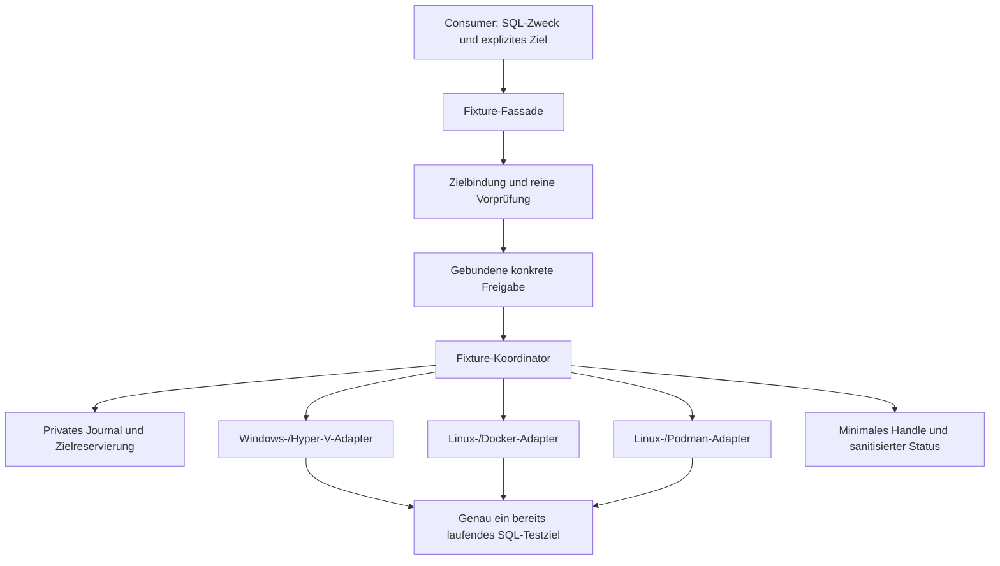

# FSF-01 – Architekturentwurf für die Fixture-Verwaltung

| Merkmal | Wert |
|---|---|
| Status | `ARCHITECTURE_DECISION_DRAFT` – zur Abstimmung, nicht freigegeben |
| Entwurf | `FSF-01`, Revision `0.1`, Stand 2026-10-11 |
| Anforderungsquelle | [Fixture-Verwaltungs-Backlog](FILESYSTEM_FIXTURE_MANAGEMENT_BACKLOG.md) |
| Repositorybasis der Bestandsanalyse | `a6b5a6b3` |
| Gegenstand | SQL-Bezug, Ziel-/Readinessbindung, interne Betreibergrenze, Abläufe und ausgeschlossene Infrastrukturaktionen |
| Autorität | Dokumentationsentwurf; keine Implementierungs- oder Runtimefreigabe |

Alle Architekturentscheidungen unten sind Vorschläge. Eine Zustimmung zu
FSF-01 genehmigt ausschließlich diesen Architekturrahmen. FSF-02 bis FSF-06
bleiben eigenständig auszuarbeiten und einzeln freizugeben. Erst nach allen
sechs Freigaben darf eine Implementierung beginnen. Es werden weder bestehende
Exports noch Provider-, Lifecycle-, Schema-, Secret- oder Stateverträge geändert.

## 1. Zweck und Verantwortungsgrenze

Die Fixture-Verwaltung ist eine unterstützende SQL-Labfunktion für synthetische
Datei-, Sicherheits- und Berechtigungs-Integrationstests. Sie stellt ein
begrenztes Arrange bereit: eigene nicht privilegierte Testidentitäten,
Verzeichnisse und Rechte innerhalb genau eines bereits laufenden ausgewählten
SQL-Testziels. Ein Berechtigungsprofil bindet die Testidentität und die aktuell
ermittelte SQL-Server-Dienstidentität an die vereinbarten eigenen Ressourcen.

Das konsumierende Projekt formuliert den SQL-Testzweck, wählt das Ziel und
fordert ein fest definiertes Fixture-Profil an. Es verantwortet seine SQL-
Workloads und fachlichen Assertions. Das Lab verantwortet ausschließlich die
Fixture-Bereitstellung, technische Nachbedingungen, lokale Ownershipdaten und
den sicheren Rückbau. Erfolg der Bereitstellung beweist noch keinen bestandenen
fachlichen SQL-Test.

Die Fixture-Schnittstelle ist kein allgemeiner Dateisystem-, Benutzer-,
Remote-Shell- oder Hostverwaltungsdienst. Der Consumer erhält weder VM-Admin-
noch Container-Root-Zugänge. Er übergibt keine freien Commands, Scriptblocks,
Installationspakete oder beliebigen absoluten Zielpfade. Identitätsarten und
Berechtigungsprofile werden in FSF-02 festgelegt; endgültige API-Namen und
Felder folgen in FSF-03.

## 2. Bestandsanalyse und Wiederverwendung

Die folgenden Befunde stammen aus den verlinkten Repositoryquellen auf der
genannten Basis. Es wurden keine Provider oder SQL-Ziele angesprochen.

| Vorhandene Quelle | Befund und Grenze für den Entwurf |
|---|---|
| [StateMachine](../../Private/StateMachine.ps1) | Run-State kennt unter anderem `SQL_READY` als Provisionierungsphase und `RUNNING` als Workflowzustand. `READY` ist hier kein neu einzuführender persistenter Run-State. |
| [Öffentlicher Labstatus](../../Public/Get-SqlServerLab.ps1) und StateMachine | Vorhandene Run-/Instanz-/Providerbezüge und Live-Runtimestatus sind nutzbare Ausgangsinformationen. Eine Statusanzeige allein ist keine Fixture-Autorität oder aktuelle SQL-Bereitschaft. |
| [SQL-Readiness](../../Private/SqlReadiness.ps1) | `Wait-SqlReady` prüft unter anderem SQL-Major und stabile Erreichbarkeit; es enthält auch Diagnosepfade. Für Fixtures muss eine eng gebundene reine Probe gesondert geprüft werden, statt den gesamten Workflow ungeprüft zu übernehmen. |
| [Hyper-V-Provider](../../Providers/HyperV/HyperVProvider.ps1) | `Get-HyperVInstanceStatus` unterscheidet historische SQL-Readiness von aktueller Bereitschaft. `Invoke-HyperVPowerShellDirect` besitzt einen VM-ID-gebundenen Pfad; der WinRM-Fallback kann den Hostdienst starten und TrustedHosts verändern. Dieser Fallback ist für den vorgeschlagenen ersten Fixture-Scope ausgeschlossen. |
| [Container-Runtime-Scope](../../Private/ContainerRuntimeScope.ps1) und [Owned-Host-Vertrag](../Architecture/OWNED_HOST_CI_ISOLATION.md) | Runtimebindung, gepinnte Providerroute, eigene Creation-Receipts und vollständige Containeridentität bieten vorhandene Bindungsregeln. Eine Runtime-Scope-ID allein beweist weder eine unveränderte Enginegeneration noch Fixture-Ownership. Die CI-Policy ist kein allgemeiner Consumervertrag. |
| [Provider-Capability-Projektion](../../Private/ProviderCapability.ps1) | Deklarierte Providerfähigkeiten sind Metadaten, keine aktuelle Empirie und keine Freigabe für Dateisystem-Fixtures. |
| [Scenario-Capability-Vertrag](../Architecture/SCENARIO_CAPABILITY_DECISION.md) und [Scenario-Backlog](SCENARIO_CONTRACT_BACKLOG.md) | Bestehende interne synthetische Szenarien erteilen keine produktive SQL-/Provider-Ausführungsautorität. Eine spätere Anbindung benötigt einen eigenen kompatiblen Slice. |
| [Bekannte Grenzen](../Quality/KNOWN_LIMITATIONS.md) | Allgemeine Maintenance-/Repairpfade können Metadaten reparieren; solche Pfade sind keine geeigneten reinen Fixture-Vorprüfungen. |

Wiederverwendung bedeutet hier Prüfung geeigneter enger Primitive. Der Entwurf
behauptet weder einen vorhandenen Fixture-Core noch eine vorhandene globale
Fixture-/Lifecycle-Sperre, einen sicheren Privilegienbroker oder eine fertige
Readiness-/Transportabnahme. Diese Lücken bleiben Implementierungsvoraussetzungen.

## 3. Vorgeschlagene Komponenten

| Komponente | Verantwortung | Darf nicht übernehmen |
|---|---|---|
| Fixture-Fassade | geschlossene Anforderung validieren; Ziel, Owner, Run und Profil verlangen; denselben Kern für spätere direkte und geführte Bedienung nutzen | freie Shell, Lifecycle, eigene Plattformwahl, Privilegienweitergabe |
| Zielbindung und Vorprüfung | lokale Vertragsbindung, Runtimeidentität, SQL-Bezug, aktuelle Readiness, Speichergrenze und benötigte Rechte prüfen | Defaults umschalten, Connection-Metadaten reparieren, unbekannte Ressourcen adoptieren |
| Freigabeprüfung | konkreten Ziel-/Owner-/Profil-/Effektscope, Gültigkeit und lokalen Aussteller prüfen | ein Handle, ein Manifestboolean oder unterdrücktes Confirm als Autorität behandeln |
| Fixture-Koordinator | begrenzte Operation und Reservierung führen, vorab journalisieren, Adapter ansteuern, Nachbedingungen und Cleanup zusammenhalten | neue Infrastruktur bereitstellen, ungebunden wiederholen, fachliche Tests starten |
| Plattformadapter | feste begrenzte Operationen im ausgewählten Gast beziehungsweise Container ausführen und tatsächliche Ressourcenbindungen zurückmelden | freie Commands, Hostpfade, fremde Ressourcen, zusätzliche Rechte oder Fallbackziele |
| Privater Store | Ownership-, Freigabe-, Fortschritts- und Recoverydaten geschützt lokal halten | Secrets oder reale Bindings in Git, öffentliche Ergebnisse oder Exports übernehmen |

Die Komponenten sind logische Verantwortungen, keine Zusage separater Prozesse,
Dienste oder fertiger Dateinamen. Vorgeschlagen wird ein lokaler Lab-Koordinator
mit privaten Adaptern. Ein dauerhaft installierter Agent, neuer Hostdienst oder
allgemeiner privilegierter RPC-Dienst ist für den ersten Scope nicht vorgesehen.

## 4. Zielbindung und Bedeutung von READY

Eine Operation bindet genau eine ausdrücklich ausgewählte SQL-Instanz innerhalb
eines bekannten Lab-Runs. Run-ID allein genügt bei Mehrinstanz- oder Mixed-Runs
nicht. Die Bindung umfasst fachlich:

- registrierten lokalen Lab-State, Owner, Run-ID, Scope-ID und Instanzreferenz;
- gespeicherten Provider, validierte Plattform und SQL-Vertragsbezug;
- bei Hyper-V die unveränderliche VM-ID und die passende Lab-/Gastbindung;
- bei Docker/Podman die vollständige Container-ID, aktuell geprüfte eigene
  Ressourcenbindung und dieselbe gepinnte Runtime-/Operationsroute;
- aktuelle Zielgeneration sowie Datei-/Mount-/Namespacegrenze, soweit für das
  angeforderte Profil erforderlich.

Dies ist noch kein Handle- oder Journalschema. FSF-03 und FSF-04 bestimmen
Serialisierung, Integrität und private Auflösung. Namen, Ports, Images, Labels,
Umgebungsvariablen oder deklarierte Plattformangaben allein genügen nicht.

Vorgeschlagen wird `READY` als zeitlich begrenztes Admission-Ergebnis der
Fixture-Vorprüfung, ohne Änderung der Run-State-Maschine. Dafür müssen alle
folgenden Bedingungen gleichzeitig erfüllt sein:

1. Das Ziel ist als autorisiertes synthetisches Lab-Testziel nachweisbar
   klassifiziert; Produktion, Shared External und unklarer Vorbestand sind
   ausgeschlossen. Eine Selbstauskunft des Requests ersetzt diesen Nachweis nicht.
2. Run und ausgewählte Instanz sind vertragsgültig, ohne Recovery-/Cleanup-
   Konflikt; die exakt gebundene VM beziehungsweise der Container läuft aktuell.
3. Eine begrenzte authentifizierte reine SQL-Probe bestätigt am gebundenen Ziel
   die erwartete SQL-Vertragsidentität. Eine Major-Version allein identifiziert
   das Ziel nicht. Bei TCP ist zusätzlich die aktuelle Endpoint-/Runtimebindung
   nachzuweisen; eine beliebige erreichbare SQL-Instanz reicht nicht.
4. Die SQL-Dienstidentität und das tatsächliche Berechtigungs-/Dateisystemmodell
   sind für das Profil aktuell prüfbar. Fehlende Rechte oder Werkzeuge blockieren.
5. Die für das Profil erforderliche Capability und konkrete Freigabe sind
   vorhanden, und die exklusive Zielreservierung kann wirksam erworben werden.

Historische Receipts, `RUNNING`, eine offene TCP-Verbindung und deklarierte
Capabilities ersetzen keine dieser Bedingungen. Prüfungen starten oder
reparieren nichts. Fehlende Authentisierung ergibt einen Blocker; SA-Passwörter
werden weder erfunden noch aus Exports übernommen. Die Probe erhält nur die
notwendigen vorhandenen Rechte und verändert keine SQL-Logins oder Konfiguration.

Vor jedem mutierenden Schritt werden relevante Bindungen und Readiness erneut
geprüft. Ein gestarteter, ersetzter oder neu gebundener Prozess/Container darf
nicht automatisch als dasselbe Ziel gelten. Fristen und die genaue Bindung
einer SQL-Dienstgeneration sind in FSF-02/FSF-05/FSF-06 zu konkretisieren.

## 5. Betreiberrechte innerhalb des Labs

Nicht privilegierte Testidentität und technische Betreiberidentität sind
verschiedene Rollen. Kontenerzeugung und bestimmte Rechteänderungen können
Betreiberrechte benötigen. Das Lab darf diese für exakt freigegebene feste
Operationen intern verwenden; der Consumer erhält sie nicht.

Vorgeschlagen wird folgende Grenze:

- Der vertrauenswürdige lokale Lab-Operator stellt vorhandene, zielgebundene
  Betreiberzugänge über den geschützten lokalen Secretkontext oder flüchtig
  bereit. Der Fixture-Aufruf installiert keine Konten für seine eigene
  Administration und startet keinen Credential-Bootstrap.
- Windows: ausschließlich ein bereits verfügbarer VM-ID-gebundener PowerShell-
  Direct-Kanal ohne WinRM-Fallback. Er führt fest im Lab definierte Aktionen
  aus. Fehlende Host-/Gastrechte oder Gastintegration blockieren vor Mutation.
- Linux: ausschließlich begrenzte Exec-Operationen innerhalb des laufenden
  exakt gebundenen Docker-/Podman-Containers. Eine interne Betreiber-UID kann
  erforderlich sein; `--privileged`, Namespacewechsel zum Host, Runtime-Socket-
  Mounts, Host-Exec und Erweiterung der bestehenden Containerrechte sind verboten.
- Für Testoperationen bleibt die Testidentität nicht privilegiert. Dienstkonto,
  SQL-Logins, bestehende Konten und fremde Gruppen werden nicht umkonfiguriert.
- Keine Secretwerte in Handle, Journalnutzdaten, DTOs oder normalen Logs;
  erforderliche Recoveryzugänge bleiben gesondert geschützt lokal. Die genaue
  Secretbereitstellung und Authentisierung folgen in FSF-03/FSF-05.

Ein lokaler Koordinator mit vorhandenen Administrator-/Runtimezugängen ist
keine Sicherheitsisolation gegen einen kompromittierten Controller, Hostadmin
oder Gast-/Containeradmin. Geschlossene Operationen begrenzen die fachliche
Schnittstelle; die weitergehenden Angriffsannahmen werden in FSF-05 geprüft.

Die Kanalauswahl stützt sich auf die Herstellerdokumentation:
[PowerShell Direct](https://learn.microsoft.com/en-us/windows-server/virtualization/hyper-v/powershell-direct)
benötigt eine laufende lokale VM, Hostberechtigung und gültige Gastcredentials.
[Docker Exec](https://docs.docker.com/reference/cli/docker/container/exec/)
und [Podman Exec](https://docs.podman.io/en/latest/markdown/podman-exec.1.html)
führen Befehle in laufenden Containern aus und erlauben eine explizite
Ausführungsidentität. Podman dokumentiert zusätzlich die Abhängigkeit der
UID/GID-Bedeutung vom User Namespace. Quellenstand: geprüft am 2026-10-11;
daraus folgt keine Abnahme einer lokalen Runtime oder Fixture-Implementierung.

## 6. Ressourcen- und Lebenszyklusgrenze

Die Fixture besitzt einen eigenen Lebenszyklus unterhalb des bestehenden
Runs. Sie ersetzt weder dessen State noch den Infrastruktur-Cleanup-Plan.
Lokale Fixture-Metadaten liegen in einem geschützten, nicht versionierten
operationsgebundenen Store außerhalb des Checkouts. Zielressourcen liegen
ausschließlich im ausgewählten Gast beziehungsweise Container.

Als Struktur wird ein neu erzeugter äußerer Fixture-Root vorgeschlagen, der
den inneren Testroot, eigene Arbeitsverzeichnisse und gegebenenfalls ein eigenes
Sentinel als Geschwister des Testroots umfasst. Damit kann das Sentinel außerhalb
des geprüften inneren Roots liegen, ohne den nachgewiesenen Fixture-Scope zu
verlassen. Arbiträre Außenpfade bleiben verboten. FSF-04 muss diese Auslegung
der Backloganforderung ausdrücklich bestätigen; sie ist hier keine Freigabe.

Der erste Scope soll gewöhnlichen Gast-/Container-Speicher verwenden, ohne
Host-Bind-Mounts oder geteilt-externe Volumes als Fixture-Speicher einzubeziehen.
Es werden keine Mounts oder Volumes angelegt, um ein fehlendes Speicherprofil
zu ermöglichen. Die genaue Platzierung, vererbte Rechte, Accountdatenbank-
Writes beim Hinzufügen eigener Konten und unterstützte Namespacevarianten
bleiben FSF-02/FSF-04/FSF-05 zugeordnet. Fremde Accountdatensätze bleiben erhalten.

Die SQL-Dienstidentität erhält das vereinbarte Profil nur auf eigenen neuen
Fixture-Ressourcen. Dienstkonfiguration, Datenbankdateien und vorbestehende
SQL-Verzeichnisse bleiben unverändert. Kein Rechteprofil wird durch globale
ACL-, Gruppen-, Policy- oder Mountänderungen ermöglicht.

## 7. Vorgeschlagene Abläufe

### Bereitstellung

1. Geschlossene Anforderung, SQL-Zweck, Zielauswahl, Owner/Run und gewünschtes
   Profil validieren. Keine eigene Infrastruktur allokieren.
2. Ziel und Capability rein prüfen; benötigte Effekte, Lebensdauer, Grenzen
   und Cleanupumfang als konkreten lokalen Plan zur Freigabe bereitstellen.
3. Die konkrete gültige Freigabe prüfen, wirksame Zielreservierung erwerben
   und Zielbindung/Readiness innerhalb der Reservierung erneut prüfen.
4. Lokalen Erzeugungsintent, Wiederherstellungsdaten und Cleanupplan vor der
   ersten Zielmutation dauerhaft schreiben. Fehler verhindert Arrange.
5. Ausschließlich eigene synthetische Ressourcen über den ausgewählten Adapter
   erzeugen; einzelne Nachbedingungen und tatsächliche Identitäten journalisieren.
6. Das gesamte Profil und die gültige Bindung prüfen; erst dann Fixture als
   bereitgestellt melden und ein minimales nicht geheimes Handle zurückgeben.

Die Vorprüfung ist kein Freigabereceipt. Drift zwischen Plan und Ausführung
blockiert; ein anderer Provider, ein Ersatzcontainer oder zusätzliche Effekte
benötigen einen neuen Plan und passende Autorität. Endgültige Freigabeform,
Versions-/Hashbindung und Limits werden in FSF-03/FSF-05 festgelegt.

### Status und Nutzung

Status trennt lokalen journalisierten Fortschritt von aktueller reiner
Zielbeobachtung. Nicht beobachtbar bedeutet unbekannt, nicht entfernt oder
bereit. Statusabfragen reparieren weder State noch Ressourcen und starten
keinen Cleanup. Datenform und endgültige Statuscodes folgen in FSF-03.

Der Consumer führt seine fachlichen Tests getrennt durch. Falls Tests unter
der erzeugten OS-Identität notwendig sind, ist in FSF-02/FSF-03 eine begrenzte
Nutzungsschnittstelle oder sichere lokale Secretübergabe zu entscheiden.
FSF-01 autorisiert dafür keine freie Run-as-Shell oder Credentials im Handle.

### Entfernung und Fehler

Remove und Fehlerkompensation verwenden dasselbe private Ownershipjournal
und denselben Ziel-/Adapterbezug. Sie prüfen vor Mutation aktuelle Bindung,
Readiness, Ressourcenidentität, Besitzer und Link-/Mountgrenzen. Unklarheit
führt zu sichtbarem Recoverybedarf statt spekulativer Löschung.

Für diesen Entwurf bleibt jede Zielmutation einschließlich Cleanup an `READY`
gebunden. Geht SQL-Bereitschaft oder der gebundene Gastzugang verloren, wird
kein Cleanup gegen ein anderes Ziel versucht und keine Infrastruktur gestartet.
Das Journal bleibt erhalten. Eine später gewünschte Cleanupausnahme bei
SQL-Ausfall wäre eine Änderung der Ausgangsanforderung und müsste ausdrücklich
in FSF-04/FSF-05 abgestimmt werden.

Lebensdauerablauf erzeugt einen sichtbaren Cleanupbedarf, keine ungebundene
TTL-Löschung. Nach Teilfehlern darf nur eindeutig bewiesene eigene Erzeugung
kompensiert werden. Verlorene Antworten dürfen keine blinde Wiederholung
auslösen. Resume, Reihenfolge, Fristen, sichere Kontenentfernung und
idempotente Absenzbelege werden in FSF-04 ausgearbeitet.

## 8. Reservierung und parallele Operationen

Vorgeschlagen wird zunächst eine aktive Fixture pro ausgewählter Instanz mit
exklusiver Zielreservierung während Arrange, Nutzung und Cleanup. Der Consumer
kennzeichnet das Nutzungsende ausdrücklich; Crash oder Fristablauf darf keine
automatische Wiederverwendung eines unklaren Scopes auslösen.

Eine Fixture-Sperre allein verhindert keinen parallelen Start/Stop/Remove,
Reconcile, SQL-Dienstwechsel oder Store-Reattach. Für spätere Ausführung muss
eine Reservierung nachweisbar von allen erreichbaren mutierenden Labpfaden
respektiert werden. Ohne solche Koordination bleibt die Ausführung blockiert.
Notwendige Änderungen bestehender Lifecyclepfade sind ein späterer eigener
Implementierungsscope nach den sechs Freigaben; dieser Entwurf führt sie nicht ein.

Direkte externe Adminaktionen sind davon nicht technisch ausgeschlossen.
Erkannte Drift blockiert die nächste Fixture-Mutation; Schutz vor Rennen und
deren verbleibende Grenzen müssen FSF-05/FSF-06 nachweisen. Bestehende Locks
dürfen ohne Prüfung ihres gesamten Teilnehmerscopes nicht als ausreichende
Fixture-Reservierung bezeichnet werden.

Für die aktuelle parallele Entwicklungswelle bedeutet dies ausschließlich:
Dokumentation im separaten Worktree, keine Provideraufrufe, keine Tests an deren
Zielen und keine Änderung ihrer Branches, Worktrees, Wellenplanung oder Gates.

## 9. Ausgeschlossene Aktionen

- VM-/Container-/Machine-/Engine-Start, Stop, Restart, Repair, Recreate oder Remove;
- Erstellung, Änderung oder Löschung von Netzen, Volumes, Mounts, VHDX,
  Checkpoints, Images, Hostdiensten oder Autostartaufträgen;
- Änderung von Firewall, TrustedHosts, Sicherheitsrichtlinien, Host-Härtung,
  SELinux-/AppArmor-/Seccomp-Profilen oder vorhandenen Namespacezuordnungen;
- Änderung fremder Benutzer, Gruppen, ACLs, Besitzer, SQL-Logins oder Dateien;
- Beschaffung fehlender Programme, Installation im Gast/Container, Austausch
  des SQL-Dienstkontos oder Aktivierung von SQL-Ausführungsfeatures;
- Hostdateisystemzugriff als Ersatz für einen gesperrten Gast-/Containerpfad;
- automatische Auswahl weiterer Ziele, Remotehosts, Produktionssysteme,
  privilegierte Testidentitäten und dauerhafte allgemeine Fixture-Agenten;
- Export realer Infrastrukturdetails, Secrets oder ungefilterter Runtimeausgaben.

## 10. Entscheidungen zur Abstimmung

| ID | Vorschlag innerhalb FSF-01 | Auswirkung beziehungsweise offene Folge |
|---|---|---|
| `A1` | Lokaler Lab-Koordinator mit privaten festen Adaptern; kein dauerhafter Agent und keine freie Shell | Betreiberzugänge verbleiben im Lab; Authentisierung und Bedrohungsmodell folgen in FSF-05. |
| `A2` | Genau eine explizite verwaltete SQL-Testinstanz pro Operation; keine Adoption und kein Providerfallback | Ziel- und Ownershipnachweise sowie minimale Handlebindung folgen in FSF-03/FSF-04. |
| `A3` | READY als frisches Admission-Ergebnis, getrennt vom persistenten Run-State | SQL-Probe, Frische und Dienstgeneration müssen in FSF-02/FSF-05/FSF-06 konkretisiert werden. |
| `A4` | PowerShell Direct mit VM-ID; gepinntes Docker-/Podman-Exec ohne zusätzliche Runtimeprivilegien | WinRM-Fallback und Rechtebootstrap ausgeschlossen; inkompatible Ziele bleiben blockiert. |
| `A5` | Eigener äußerer Fixture-Root; Outside-Sentinel nur außerhalb des inneren Testroots innerhalb dieses Scopes | Die Auslegung ist in FSF-04 gesondert zu bestätigen; Host-/Shared-Volume-Profile bleiben zunächst offen. |
| `A6` | Jede Zielmutation einschließlich Cleanup benötigt READY; Verlust erzeugt Recoverybedarf | Kein Rückbau durch Start/Repair; eine SQL-unabhängige Cleanupausnahme benötigt eigene Entscheidung. |
| `A7` | Zunächst eine aktive Fixture pro Instanz mit einer auch von Lifecyclepfaden respektierten Reservierung | Keine Ausführung, solange die wirksame Koordination fehlt; Mehrfixture-Nutzung ist ein späterer Scope. |
| `A8` | FSF-01-Zustimmung genehmigt nur den Architekturrahmen | FSF-02 bis FSF-06 und sämtliche Implementierungs-/Runtimefreigaben bleiben offen. |

Zum Abschluss der Abstimmung sind Zustimmung oder konkrete Änderungen zu
diesem Rahmen festzuhalten. Der Stand bleibt bis dahin `PENDING`; aus diesem
Dokument, seinen Quellen oder einer bestandenen Dokumentationsprüfung folgt
keine Freigabe einer Zieloperation.

## 11. Nächste Entwurfsarbeit und Nachweisgrenze

Nach Architekturabstimmung folgt FSF-02 mit der konkreten Fähigkeitsmatrix
für Windows/Hyper-V, Linux/Docker und Linux/Podman. FSF-03 bis FSF-06 liefern
danach Handle-/Freigabebindung, Ownership-/Cleanupdetails, Bedrohungsmodell
und getrennte Testnachweise. Noch offen bleiben insbesondere UID/GID-
Reservierung, NTFS-Details, sichere Linkoperationen, Accountdatenbank-
Nebenwirkungen, Recovery bei SQL-Ausfall und Lifecycle-Reservierung.

Die [Arbeitsregeln](../../.ai/WORKING_RULES.md),
[Repo-Map](../../.ai/repo_map.yaml), der
[Projektintegrationsvertrag](../Architecture/PROJECT_INTEGRATION_CONTRACT.md),
[Storage-Backlog](PERSISTENT_STORAGE_REUSE_AND_LAB_DATA_BACKLOG.md) und die
[Validierungsstrategie](../Quality/LOCAL_VALIDATION_STRATEGY.md) bleiben
maßgebliche gekoppelte Quellen. Keine Nachbarabnahme wird zur Fixture-Evidence
umgedeutet. Dieser Dokumentationsslice prüft Auffindbarkeit, Konsistenz und
Privacy; sämtliche nativen Fixture- und SQL-Nachweise sind nicht ausgeführt.
