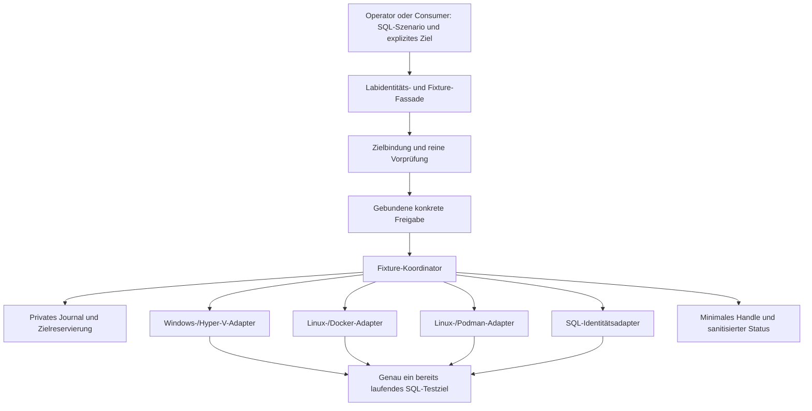

# FSF-01 – Freigegebener Architekturrahmen für Labidentitäten und Dateisystem-Fixtures

| Merkmal | Wert |
|---|---|
| Status | `ARCHITECTURE_FRAMEWORK_APPROVED` – Architekturrahmen freigegeben |
| Entwurf | `FSF-01`, Revision `0.2`, Stand 2026-10-11 |
| Freigabe | ausdrücklich durch den Repository-Eigentümer am 2026-10-11, einschließlich getrennter OS-/SQL-Identitäten für manuelle und automatisierte Szenarien |
| Anforderungsquelle | [Fixture-Verwaltungs-Backlog](FILESYSTEM_FIXTURE_MANAGEMENT_BACKLOG.md) |
| Repositorybasis der Bestandsanalyse | `a6b5a6b3` |
| Gegenstand | SQL-Bezug, Ziel-/Readinessbindung, interne Betreibergrenze, Abläufe und ausgeschlossene Infrastrukturaktionen |
| Autorität | freigegebener Architekturrahmen; keine Implementierungs- oder Runtimefreigabe |

Die Architekturentscheidungen A1 bis A10 wurden ausdrücklich freigegeben.
Diese Zustimmung zu FSF-01 genehmigt ausschließlich den Architekturrahmen.
FSF-02 und FSF-03 wurden anschließend als Fähigkeitsmodell und Handle-Vertrag
freigegeben; FSF-04 bis FSF-06
bleiben eigenständig auszuarbeiten und einzeln freizugeben. Erst nach allen
sechs Freigaben darf eine Implementierung beginnen. Es werden weder bestehende
Exports noch Provider-, Lifecycle-, Schema-, Secret- oder Stateverträge geändert.

## 1. Zweck und Verantwortungsgrenze

Die Verwaltung von Labidentitäten und Dateisystem-Fixtures unterstützt
automatisierte Tests ebenso wie manuelle Schulungen, Demonstrationen und die
Rekonstruktion von SQL-Server-Szenarien mit unterschiedlichen Benutzern.
`SQL_PerformanceSchulung` ist ein ausdrücklich benannter Bedarfsträger;
`SQL_Server_Toolbelt` ist ein weiterer möglicher Consumer, keine Voraussetzung.
Ein Testexecutor oder Project Adapter muss für eine direkte Benutzeranlage
nicht laufen. Alle Identitäten bleiben synthetisch und nicht privilegiert.

Innerhalb genau eines bereits laufenden ausgewählten SQL-Labziels sollen
OS-Benutzer sowie SQL-Logins und Datenbankbenutzer ausdrücklich angelegt werden
können. Ihre Anlage ist eine eigenständige Laboperation, unabhängig von einer
Dateisystem-Fixture. Verzeichnisse und Dateirechte sind ein zusätzliches,
optional kombinierbares Ressourcenprofil. Nur ein Dateisystemprofil bindet
die OS-Identität und die aktuell ermittelte SQL-Server-Dienstidentität an die
vereinbarten eigenen Dateisystemressourcen.

Der Operator beziehungsweise das konsumierende Projekt formuliert den
SQL-Szenariozweck, wählt das Ziel und fordert fest definierte Identitäts- und
gegebenenfalls Dateisystemprofile an. Er verantwortet Schulungsabläufe,
Workloads und fachliche Assertions. Das Lab verantwortet Bereitstellung,
technische Nachbedingungen, lokale Ownershipdaten und sicheren Rückbau.
Bereitstellungserfolg beweist noch keinen bestandenen fachlichen SQL-Test.

Die Schnittstelle bleibt auf eigene SQL-Labidentitäten und optionale
Dateisystemressourcen begrenzt; sie ist kein allgemeiner Remote-Shell- oder
Hostverwaltungsdienst. Der Consumer erhält weder VM-Admin-
noch Container-Root-Zugänge. Er übergibt keine freien Commands, Scriptblocks,
Installationspakete oder beliebigen absoluten Zielpfade. Identitätsarten und
Berechtigungsprofile werden in FSF-02 festgelegt; endgültige API-Namen und
Felder folgen in FSF-03.

### Eigenständige Identitätsverträge

| Vertrag | Geplanter Gegenstand | Abgrenzung |
|---|---|---|
| OS-Identität | synthetischer lokaler Windows-Benutzer beziehungsweise Linux-Benutzer/UID/GID im ausgewählten Gast oder Container | Kein automatischer SQL-Zugang; keine Host-, Domain- oder Adminidentität. |
| SQL-Identität | neues synthetisches SQL-Login und/oder Datenbankbenutzer mit ausdrücklich gewähltem nicht privilegiertem Berechtigungsprofil | Eigenständige SQL-Ziel-/Datenbankbindung, keine Voraussetzung eines OS-Benutzers oder eines Dateisystemroots. |
| Dateisystem-Fixture | eigene Verzeichnisse, Dateirechte und optionale Link-/Sentinel-Fälle | Optionales Profil mit eigener Ressourcen-Ownership; kann ausdrücklich an eine bereits durch das Lab erzeugte und erneut geprüfte OS-Identität gebunden werden. |

OS- und SQL-Identität besitzen getrennte Erzeugungsnachweise, Ressourcen-
identitäten und Cleanupabhängigkeiten. Ein Login und ein Datenbankbenutzer
sind ebenfalls getrennte SQL-Principals. Ihre Zuordnung muss ausdrücklich
geplant werden; Namensgleichheit stellt keine Verbindung her. Die fachliche
Unterscheidung folgt der Microsoft-Dokumentation zu
[Logins und Datenbankberechtigungen](https://learn.microsoft.com/en-us/sql/relational-databases/security/authentication-access/getting-started-with-database-engine-permissions?view=sql-server-ver17).

FSF-02 bestimmt die konkreten Authentisierungsarten und Plattformfähigkeiten,
FSF-03 die getrennten Requests und Handles. Windows-Authentication-Verknüpfung,
Domain-/Kerberos-Identitäten und enthaltene Datenbankbenutzer werden nicht
stillschweigend zugesagt. Bestehende Authentisierungsmodi werden nicht geändert.

Ein vorgeschlagenes Anforderungsbeispiel für `SQL_PerformanceSchulung` ist die
manuelle Rekonstruktion eines Falls mit zwei neu erzeugten SQL-Benutzern und
unterschiedlichen ausdrücklich gewählten Rechten in einer ausgewählten
Labdatenbank. Dazu können unabhängig eigene OS-Benutzer für lokale
Dateizugriffsfälle angelegt werden. Das ist ein Planungsbeispiel aus dem
Benutzerbedarf, kein Nachweis eines vorhandenen Schulungsmoduls.

## 2. Bestandsanalyse und Wiederverwendung

Die folgenden Befunde stammen aus den verlinkten Repositoryquellen auf der
genannten Basis. Es wurden keine Provider oder SQL-Ziele angesprochen.

| Vorhandene Quelle | Befund und Grenze für den Entwurf |
|---|---|
| [StateMachine](../../Private/StateMachine.ps1) | Run-State kennt unter anderem `SQL_READY` als Provisionierungsphase und `RUNNING` als Workflowzustand. `READY` ist hier kein neu einzuführender persistenter Run-State. |
| [Öffentlicher Labstatus](../../Public/Get-SqlServerLab.ps1) und StateMachine | Vorhandene Run-/Instanz-/Providerbezüge und Live-Runtimestatus sind nutzbare Ausgangsinformationen. Eine Statusanzeige allein ist keine Fixture-Autorität oder aktuelle SQL-Bereitschaft. |
| [SQL-Readiness](../../Private/SqlReadiness.ps1) | `Wait-SqlReady` prüft unter anderem SQL-Major und stabile Erreichbarkeit; es enthält auch Diagnosepfade. Für Fixtures muss eine eng gebundene reine Probe gesondert geprüft werden, statt den gesamten Workflow ungeprüft zu übernehmen. |
| [Hyper-V-Provider](../../Providers/HyperV/HyperVProvider.ps1) | `Get-HyperVInstanceStatus` unterscheidet historische SQL-Readiness von aktueller Bereitschaft. `Invoke-HyperVPowerShellDirect` besitzt einen VM-ID-gebundenen Pfad; der WinRM-Fallback kann den Hostdienst starten und TrustedHosts verändern. Dieser Fallback ist für den vorgeschlagenen ersten Fixture-Scope ausgeschlossen. |
| [Container-Runtime-Scope](../../Private/ContainerRuntimeScope.ps1) und [Owned-Host-Vertrag](../Architecture/OWNED_HOST_CI_ISOLATION.md) | Runtimebindung, gepinnte Providerroute, eigene Creation-Receipts und vollständige Containeridentität bieten vorhandene Bindungsregeln. Eine Runtime-Scope-ID allein beweist weder eine unveränderte Enginegeneration noch Fixture-Ownership. Die CI-Policy ist kein allgemeiner Consumervertrag. |
| [Provider-Capability-Projektion](../../Private/ProviderCapability.ps1) | Deklarierte Providerfähigkeiten sind Metadaten, keine aktuelle Empirie und keine Freigabe für Dateisystem-Fixtures. |
| [Scenario-Capability-Vertrag](../Architecture/SCENARIO_CAPABILITY_DECISION.md) und [Scenario-Backlog](SCENARIO_CONTRACT_BACKLOG.md) | Bestehende interne synthetische Szenarien erteilen keine produktive SQL-/Provider-Ausführungsautorität. Eine spätere Anbindung benötigt einen eigenen kompatiblen Slice. |
| [Bekannte Grenzen](../Quality/KNOWN_LIMITATIONS.md) | Allgemeine Maintenance-/Repairpfade können Metadaten reparieren; solche Pfade sind keine geeigneten reinen Fixture-Vorprüfungen. |

Wiederverwendung bedeutet hier Prüfung geeigneter enger Primitive. Der Entwurf
behauptet weder einen vorhandenen Fixture-Core noch eine vorhandene globale
Fixture-/Lifecycle-Sperre, einen sicheren Privilegienbroker oder eine fertige
Readiness-/Transportabnahme. Diese Lücken bleiben Implementierungsvoraussetzungen.

## 3. Vorgeschlagene Komponenten

| Komponente | Verantwortung | Darf nicht übernehmen |
|---|---|---|
| Fixture-Fassade | geschlossene Anforderung validieren; Ziel, Owner, Run und Profil verlangen; denselben Kern für spätere direkte und geführte Bedienung nutzen | freie Shell, Lifecycle, eigene Plattformwahl, Privilegienweitergabe |
| Zielbindung und Vorprüfung | lokale Vertragsbindung, Runtimeidentität, SQL-Bezug, aktuelle Readiness, Speichergrenze und benötigte Rechte prüfen | Defaults umschalten, Connection-Metadaten reparieren, unbekannte Ressourcen adoptieren |
| Freigabeprüfung | konkreten Ziel-/Owner-/Profil-/Effektscope, Gültigkeit und lokalen Aussteller prüfen | ein Handle, ein Manifestboolean oder unterdrücktes Confirm als Autorität behandeln |
| Fixture-Koordinator | begrenzte Operation und Reservierung führen, vorab journalisieren, Adapter ansteuern, Nachbedingungen und Cleanup zusammenhalten | neue Infrastruktur bereitstellen, ungebunden wiederholen, fachliche Tests starten |
| Plattformadapter | feste begrenzte Operationen im ausgewählten Gast beziehungsweise Container ausführen und tatsächliche Ressourcenbindungen zurückmelden | freie Commands, Hostpfade, fremde Ressourcen, zusätzliche Rechte oder Fallbackziele |
| SQL-Identitätsadapter | feste ziel-/datenbankgebundene Login-/Benutzeroperationen und Profile ausführen; eigene SQL-Principals und Zuordnungen separat nachweisen | freie SQL-Payloads als Betreiberoperation, bestehende Logins/Benutzer übernehmen, automatische Datenbankanlage oder Authentisierungsänderung |
| Privater Store | Ownership-, Freigabe-, Fortschritts- und Recoverydaten geschützt lokal halten | Secrets oder reale Bindings in Git, öffentliche Ergebnisse oder Exports übernehmen |

Die Komponenten sind logische Verantwortungen, keine Zusage separater Prozesse,
Dienste oder fertiger Dateinamen. Vorgeschlagen wird ein lokaler Lab-Koordinator
mit privaten Adaptern. Ein dauerhaft installierter Agent, neuer Hostdienst oder
allgemeiner privilegierter RPC-Dienst ist für den ersten Scope nicht vorgesehen.

## 4. Zielbindung und Bedeutung von READY

Eine Operation bindet genau eine ausdrücklich ausgewählte SQL-Instanz innerhalb
eines bekannten Lab-Runs. Run-ID allein genügt bei Mehrinstanz- oder Mixed-Runs
nicht. Die Bindung umfasst fachlich:

- registrierten lokalen Lab-State, Owner, Run-ID, Scope-ID und Instanzreferenz;
- gespeicherten Provider, validierte Plattform und SQL-Vertragsbezug;
- bei Hyper-V die unveränderliche VM-ID und die passende Lab-/Gastbindung;
- bei Docker/Podman die vollständige Container-ID, aktuell geprüfte eigene
  Ressourcenbindung und dieselbe gepinnte Runtime-/Operationsroute;
- aktuelle Zielgeneration sowie Datei-/Mount-/Namespacegrenze, soweit für das
  angeforderte Profil erforderlich.

Dies ist noch kein Handle- oder Journalschema. FSF-03 und FSF-04 bestimmen
Serialisierung, Integrität und private Auflösung. Namen, Ports, Images, Labels,
Umgebungsvariablen oder deklarierte Plattformangaben allein genügen nicht.

Vorgeschlagen wird `READY` als zeitlich begrenztes Admission-Ergebnis der
Fixture-Vorprüfung, ohne Änderung der Run-State-Maschine. Dafür müssen alle
folgenden Bedingungen gleichzeitig erfüllt sein:

1. Das Ziel ist als autorisiertes synthetisches SQL-Labziel für Test, Schulung,
   Demonstration oder Rekonstruktion nachweisbar
   klassifiziert; Produktion, Shared External und unklarer Vorbestand sind
   ausgeschlossen. Eine Selbstauskunft des Requests ersetzt diesen Nachweis nicht.
2. Run und ausgewählte Instanz sind vertragsgültig, ohne Recovery-/Cleanup-
   Konflikt; die exakt gebundene VM beziehungsweise der Container läuft aktuell.
3. Eine begrenzte authentifizierte reine SQL-Probe bestätigt am gebundenen Ziel
   die erwartete SQL-Vertragsidentität. Eine Major-Version allein identifiziert
   das Ziel nicht. Bei TCP ist zusätzlich die aktuelle Endpoint-/Runtimebindung
   nachzuweisen; eine beliebige erreichbare SQL-Instanz reicht nicht.
4. Die für die angeforderten Identitäts-/Dateisystemprofile notwendigen
   Berechtigungen und Zielgrenzen sind aktuell prüfbar. Dateisystemprofile
   verlangen zusätzlich die SQL-Dienstidentität und das reale Dateisystemmodell;
   reine SQL-Benutzeranlage verlangt keinen OS-Adminzugang. SQL-Benutzer binden
   jede ausgewählte bestehende Labdatenbank an ihre aktuell geprüfte Identität.
   Fehlende Rechte oder Werkzeuge blockieren.
5. Die für das Profil erforderliche Capability und konkrete Freigabe sind
   vorhanden, und die exklusive Zielreservierung kann wirksam erworben werden.

Historische Receipts, `RUNNING`, eine offene TCP-Verbindung und deklarierte
Capabilities ersetzen keine dieser Bedingungen. Prüfungen starten oder
reparieren nichts. Fehlende Authentisierung ergibt einen Blocker; SA-Passwörter
werden weder erfunden noch aus Exports übernommen. Die Probe erhält nur die
notwendigen vorhandenen Rechte und verändert keine SQL-Logins oder Konfiguration.

Vor jedem mutierenden Schritt werden relevante Bindungen und Readiness erneut
geprüft. Ein gestarteter, ersetzter oder neu gebundener Prozess/Container darf
nicht automatisch als dasselbe Ziel gelten. Fristen und die genaue Bindung
einer SQL-Dienstgeneration sind in FSF-02/FSF-05/FSF-06 zu konkretisieren.

## 5. Betreiberrechte innerhalb des Labs

Nicht privilegierte Testidentität und technische Betreiberidentität sind
verschiedene Rollen. Kontenerzeugung und bestimmte Rechteänderungen können
Betreiberrechte benötigen. Das Lab darf diese für exakt freigegebene feste
Operationen intern verwenden; der Consumer erhält sie nicht.

Vorgeschlagen wird folgende Grenze:

- Der vertrauenswürdige lokale Lab-Operator stellt vorhandene, zielgebundene
  Betreiberzugänge über den geschützten lokalen Secretkontext oder flüchtig
  bereit. Der Fixture-Aufruf installiert keine Konten für seine eigene
  Administration und startet keinen Credential-Bootstrap.
- Windows: ausschließlich ein bereits verfügbarer VM-ID-gebundener PowerShell-
  Direct-Kanal ohne WinRM-Fallback. Er führt fest im Lab definierte Aktionen
  aus. Fehlende Host-/Gastrechte oder Gastintegration blockieren vor Mutation.
- Linux: ausschließlich begrenzte Exec-Operationen innerhalb des laufenden
  exakt gebundenen Docker-/Podman-Containers. Eine interne Betreiber-UID kann
  erforderlich sein; `--privileged`, Namespacewechsel zum Host, Runtime-Socket-
  Mounts, Host-Exec und Erweiterung der bestehenden Containerrechte sind verboten.
- Für Testoperationen bleibt die Testidentität nicht privilegiert. Dienstkonto,
  bestehende SQL-Logins, Konten und fremde Gruppen werden nicht umkonfiguriert.
- SQL-Identitäten werden über vorhandene, geschützte SQL-Betreiberzugänge mit
  den notwendigen Rechten angelegt. Diese Zugänge sind von den neu erzeugten
  Szenariobenutzern getrennt und werden ihnen nicht weitergegeben. Neue eigene
  Logins, Benutzer und ihre ausdrücklich freigegebenen Berechtigungen sind
  erlaubt; vorbestehende SQL-Principals bleiben unverändert. Datenbanken werden
  nicht automatisch angelegt, fremde Objektdefinitionen nicht geändert.
- Keine Secretwerte in Handle, Journalnutzdaten, DTOs oder normalen Logs;
  erforderliche Recoveryzugänge bleiben gesondert geschützt lokal. Die genaue
  Secretbereitstellung und Authentisierung folgen in FSF-03/FSF-05.

Ein lokaler Koordinator mit vorhandenen Administrator-/Runtimezugängen ist
keine Sicherheitsisolation gegen einen kompromittierten Controller, Hostadmin
oder Gast-/Containeradmin. Geschlossene Operationen begrenzen die fachliche
Schnittstelle; die weitergehenden Angriffsannahmen werden in FSF-05 geprüft.

Die Kanalauswahl stützt sich auf die Herstellerdokumentation:
[PowerShell Direct](https://learn.microsoft.com/en-us/windows-server/virtualization/hyper-v/powershell-direct)
benötigt eine laufende lokale VM, Hostberechtigung und gültige Gastcredentials.
[Docker Exec](https://docs.docker.com/reference/cli/docker/container/exec/)
und [Podman Exec](https://docs.podman.io/en/latest/markdown/podman-exec.1.html)
führen Befehle in laufenden Containern aus und erlauben eine explizite
Ausführungsidentität. Podman dokumentiert zusätzlich die Abhängigkeit der
UID/GID-Bedeutung vom User Namespace. Quellenstand: geprüft am 2026-10-11;
daraus folgt keine Abnahme einer lokalen Runtime oder Fixture-Implementierung.

## 6. Ressourcen- und Lebenszyklusgrenze

Die Fixture besitzt einen eigenen Lebenszyklus unterhalb des bestehenden
Runs. Sie ersetzt weder dessen State noch den Infrastruktur-Cleanup-Plan.
Lokale Fixture-Metadaten liegen in einem geschützten, nicht versionierten
operationsgebundenen Store außerhalb des Checkouts. Zielressourcen liegen
ausschließlich im ausgewählten Gast beziehungsweise Container.

Eigenständige OS- und SQL-Identitäten besitzen ebenfalls einen eigenen
Ressourcenlebenszyklus unterhalb des Runs; SQL-Identitäten liegen in der
gebundenen SQL-Instanz beziehungsweise der ausgewählten Labdatenbank.
Ein Szenario kann mehrere Identitäten und optionale Dateisystem-Fixtures
zusammenfassen. Keine bewusst aufbewahrte Identität wird entfernt, nur weil ein
einzelner Test oder eine Dateisystem-Fixture endet.

Vorgeschlagen sind zwei ausdrücklich gewählte Nutzungsformen: operationseigen
bis zum Ende eines automatisierten Tests oder bewusst aufbewahrt für ein
manuelles Schulungs-/Rekonstruktionsszenario bis zum festgelegten Nutzungsende
innerhalb des Lab-Runs. Auch aufbewahrte Identitäten benötigen Owner,
Lebensdauer, lokale Secrets und Cleanupnachweis. Sie sind keine allgemeinen
dauerhaften Konten. Das Ende eines Arrange-Aufrufs ist nicht das Nutzungsende.
Run-Ende und offene Identitätsressourcen müssen in FSF-04 koordiniert werden;
eine automatische Infrastrukturentfernung ist weiterhin ausgeschlossen.

Als Struktur wird ein neu erzeugter äußerer Fixture-Root vorgeschlagen, der
den inneren Testroot, eigene Arbeitsverzeichnisse und gegebenenfalls ein eigenes
Sentinel als Geschwister des Testroots umfasst. Damit kann das Sentinel außerhalb
des geprüften inneren Roots liegen, ohne den nachgewiesenen Fixture-Scope zu
verlassen. Arbiträre Außenpfade bleiben verboten. FSF-04 muss diese Auslegung
der Backloganforderung ausdrücklich bestätigen; sie ist hier keine Freigabe.

Der erste Scope soll gewöhnlichen Gast-/Container-Speicher verwenden, ohne
Host-Bind-Mounts oder geteilt-externe Volumes als Fixture-Speicher einzubeziehen.
Es werden keine Mounts oder Volumes angelegt, um ein fehlendes Speicherprofil
zu ermöglichen. Die genaue Platzierung, vererbte Rechte, Accountdatenbank-
Writes beim Hinzufügen eigener Konten und unterstützte Namespacevarianten
bleiben FSF-02/FSF-04/FSF-05 zugeordnet. Fremde Accountdatensätze bleiben erhalten.

Diese Rootstruktur gilt nur für angeforderte Dateisystem-Fixtures. Eine reine
Identitätsanlage erzeugt keinen künstlichen Dateisystemroot. SQL-Identitäts-
Ownership wird an SQL-Principals und Datenbanken gebunden, nicht an einen
Verzeichnisnamen. Genaue SID-/Objektidentitäts-, Rechte- und Driftprüfungen
werden in FSF-03 bis FSF-05 ausgearbeitet.

Die SQL-Dienstidentität erhält das vereinbarte Profil nur auf eigenen neuen
Fixture-Ressourcen. Dienstkonfiguration, Datenbankdateien und vorbestehende
SQL-Verzeichnisse bleiben unverändert. Kein Rechteprofil wird durch globale
ACL-, Gruppen-, Policy- oder Mountänderungen ermöglicht.

## 7. Vorgeschlagene Abläufe

### Bereitstellung

1. Geschlossene Anforderung, SQL-Zweck, Zielauswahl, Owner/Run, mehrere mögliche
   Identitäten, optionale Dateisystemprofile und die ausdrücklich gewünschte
   Nutzungsform validieren. Kein Testexecutor und keine Dateisystem-Fixture
   werden für Benutzeranlage vorausgesetzt. Keine Infrastruktur allokieren.
2. Ziel und Capability rein prüfen; benötigte Effekte, Lebensdauer, Grenzen
   und Cleanupumfang als konkreten lokalen Plan zur Freigabe bereitstellen.
3. Die konkrete gültige Freigabe prüfen, wirksame Zielreservierung erwerben
   und Zielbindung/Readiness innerhalb der Reservierung erneut prüfen.
4. Lokalen Erzeugungsintent, Wiederherstellungsdaten und Cleanupplan vor der
   ersten Zielmutation dauerhaft schreiben. Fehler verhindert Arrange.
5. Ausschließlich eigene synthetische Ressourcen über den ausgewählten Adapter
   erzeugen; einzelne Nachbedingungen und tatsächliche Identitäten journalisieren.
6. Das gesamte Profil und die gültige Bindung prüfen; erst dann Fixture als
   bereitgestellt melden und ein minimales nicht geheimes Handle zurückgeben.

Die Vorprüfung ist kein Freigabereceipt. Drift zwischen Plan und Ausführung
blockiert; ein anderer Provider, ein Ersatzcontainer oder zusätzliche Effekte
benötigen einen neuen Plan und passende Autorität. Endgültige Freigabeform,
Versions-/Hashbindung und Limits werden in FSF-03/FSF-05 festgelegt.

### Status und Nutzung

Status trennt lokalen journalisierten Fortschritt von aktueller reiner
Zielbeobachtung. Nicht beobachtbar bedeutet unbekannt, nicht entfernt oder
bereit. Statusabfragen reparieren weder State noch Ressourcen und starten
keinen Cleanup. Datenform und endgültige Statuscodes folgen in FSF-03.

Der Operator beziehungsweise Consumer nutzt die angelegten Identitäten für
manuelle Sitzungen, Schulungen, Rekonstruktionsfälle oder automatisierte Tests.
Die Bedienung muss Anlage und bewusste Aufbewahrung direkt ermöglichen, ohne
Kopplung an SCN-Executor oder Toolbelt. Die spätere öffentliche API muss gemäß
Projektvertrag auch über den Konsolenbefehlszugang erreichbar sein.

Für manuelle Anmeldung, etwa mit einem neuen SQL-Login in einem SQL-Client,
wird eine separate sichere lokale Bereitstellung der eigenen Benutzer-
Zugangsdaten benötigt. Für OS-Nutzung sind vorhandene zulässige Gast- oder
Containerzugänge zu berücksichtigen. Passwortlose Modelle und maskierte,
flüchtige oder lokal geschützt abrufbare Zugangsdaten sind in FSF-02/FSF-03/
FSF-05 zu entscheiden. Betreibercredentials und normale DTOs/Handles bleiben
von dieser Übergabe getrennt. Das Lab aktiviert dafür weder RDP noch Firewall-
oder Authentisierungsfeatures und bietet keine freie privilegierte Run-as-Shell.

### Entfernung und Fehler

Remove und Fehlerkompensation verwenden dasselbe private Ownershipjournal
und denselben Ziel-/Adapterbezug. Sie prüfen vor Mutation aktuelle Bindung,
Readiness und die zum Ressourcentyp gehörenden Identitäts- und Ownershipbelege.
Dateisystemressourcen verlangen Besitzer-/Link-/Mountprüfungen; SQL-Identitäten
verlangen ihre eigenen Principal-, Datenbank- und Abhängigkeitsprüfungen,
ohne einen OS-Adminzugang zu erzwingen. Unklarheit
führt zu sichtbarem Recoverybedarf statt spekulativer Löschung.

Für diesen Entwurf bleibt jede Zielmutation einschließlich Cleanup an `READY`
gebunden. Geht SQL-Bereitschaft oder der gebundene Gastzugang verloren, wird
kein Cleanup gegen ein anderes Ziel versucht und keine Infrastruktur gestartet.
Das Journal bleibt erhalten. Eine später gewünschte Cleanupausnahme bei
SQL-Ausfall wäre eine Änderung der Ausgangsanforderung und müsste ausdrücklich
in FSF-04/FSF-05 abgestimmt werden.

Lebensdauerablauf erzeugt einen sichtbaren Cleanupbedarf, keine ungebundene
TTL-Löschung. Nach Teilfehlern darf nur eindeutig bewiesene eigene Erzeugung
kompensiert werden. Verlorene Antworten dürfen keine blinde Wiederholung
auslösen. Resume, Reihenfolge, Fristen, sichere Kontenentfernung und
idempotente Absenzbelege werden in FSF-04 ausgearbeitet.

## 8. Reservierung und parallele Operationen

Der freigegebene Rahmen sieht zunächst einen aktiven Szenario-Ressourcenscope pro ausgewählter
Instanz mit mehreren ausdrücklich angeforderten Benutzern und optionalen
Dateisystem-Fixtures. Die Beschränkung bedeutet nicht einen Benutzer pro Lab.
Mutierende Anlage, Erweiterung und Cleanup werden exklusiv serialisiert.
Die Zielreservierung schützt den genutzten Scope gegen widersprüchliche
Lifecycleaktionen, ohne mehrere manuelle SQL-Sitzungen unter den eigenen
Szenariobenutzern zu verhindern. Operator oder Consumer kennzeichnet das
Nutzungsende ausdrücklich; Crash oder Fristablauf darf keine automatische
Wiederverwendung eines unklaren Scopes auslösen.

Eine Fixture-Sperre allein verhindert keinen parallelen Start/Stop/Remove,
Reconcile, SQL-Dienstwechsel oder Store-Reattach. Für spätere Ausführung muss
eine Reservierung nachweisbar von allen erreichbaren mutierenden Labpfaden
respektiert werden. Ohne solche Koordination bleibt die Ausführung blockiert.
Notwendige Änderungen bestehender Lifecyclepfade sind ein späterer eigener
Implementierungsscope nach den sechs Freigaben; dieser Entwurf führt sie nicht ein.

Direkte externe Adminaktionen sind davon nicht technisch ausgeschlossen.
Erkannte Drift blockiert die nächste Fixture-Mutation; Schutz vor Rennen und
deren verbleibende Grenzen müssen FSF-05/FSF-06 nachweisen. Bestehende Locks
dürfen ohne Prüfung ihres gesamten Teilnehmerscopes nicht als ausreichende
Fixture-Reservierung bezeichnet werden.

Für die aktuelle parallele Entwicklungswelle bedeutet dies ausschließlich:
Dokumentation im separaten Worktree, keine Provideraufrufe, keine Tests an deren
Zielen und keine Änderung ihrer Branches, Worktrees, Wellenplanung oder Gates.

## 9. Ausgeschlossene Aktionen

- VM-/Container-/Machine-/Engine-Start, Stop, Restart, Repair, Recreate oder Remove;
- Erstellung, Änderung oder Löschung von Netzen, Volumes, Mounts, VHDX,
  Checkpoints, Images, Hostdiensten oder Autostartaufträgen;
- Änderung von Firewall, TrustedHosts, Sicherheitsrichtlinien, Host-Härtung,
  SELinux-/AppArmor-/Seccomp-Profilen oder vorhandenen Namespacezuordnungen;
- Änderung fremder Benutzer, Gruppen, ACLs, Besitzer, SQL-Logins oder Dateien;
- Beschaffung fehlender Programme, Installation im Gast/Container, Austausch
  des SQL-Dienstkontos oder Aktivierung von SQL-Ausführungsfeatures;
- Hostdateisystemzugriff als Ersatz für einen gesperrten Gast-/Containerpfad;
- automatische Auswahl weiterer Ziele, Remotehosts, Produktionssysteme,
  privilegierte Testidentitäten und dauerhafte allgemeine Fixture-Agenten;
- Export realer Infrastrukturdetails, Secrets oder ungefilterter Runtimeausgaben.

## 10. Freigegebene Architekturentscheidungen

| ID | Freigegebener Rahmen innerhalb FSF-01 | Auswirkung beziehungsweise offene Folge |
|---|---|---|
| `A1` | Lokaler Lab-Koordinator mit privaten festen OS-/Dateisystem- und SQL-Identitätsadaptern; kein dauerhafter Agent und keine freie Shell | Betreiberzugänge verbleiben im Lab; Authentisierung und Bedrohungsmodell folgen in FSF-05. |
| `A2` | Genau eine explizite verwaltete SQL-Testinstanz pro Operation; keine Adoption und kein Providerfallback | Ziel- und Ownershipnachweise sowie minimale Handlebindung folgen in FSF-03/FSF-04. |
| `A3` | READY als frisches Admission-Ergebnis, getrennt vom persistenten Run-State | SQL-Probe, Frische und Dienstgeneration müssen in FSF-02/FSF-05/FSF-06 konkretisiert werden. |
| `A4` | PowerShell Direct mit VM-ID; gepinntes Docker-/Podman-Exec ohne zusätzliche Runtimeprivilegien | WinRM-Fallback und Rechtebootstrap ausgeschlossen; inkompatible Ziele bleiben blockiert. |
| `A5` | Eigener äußerer Fixture-Root; Outside-Sentinel nur außerhalb des inneren Testroots innerhalb dieses Scopes | Die Auslegung ist in FSF-04 gesondert zu bestätigen; Host-/Shared-Volume-Profile bleiben zunächst offen. |
| `A6` | Jede Zielmutation einschließlich Cleanup benötigt READY; Verlust erzeugt Recoverybedarf | Kein Rückbau durch Start/Repair; eine SQL-unabhängige Cleanupausnahme benötigt eigene Entscheidung. |
| `A7` | Zunächst ein Szenario-Ressourcenscope pro Instanz mit mehreren Benutzern und optionalen Fixtures; wirksame Lifecycle-Reservierung und serialisierte Mutationen | Manuelle Parallelsitzungen sind vorgesehen; unabhängige überlappende Szenarioscopes bleiben ein späterer Scope. |
| `A8` | FSF-01-Zustimmung genehmigt nur den Architekturrahmen | FSF-02 bis FSF-06 benötigen separate Einzelfreigaben; sämtliche Implementierungs-/Runtimefreigaben bleiben offen. |
| `A9` | OS-Identitäten sowie SQL-Logins/Datenbankbenutzer als getrennte eigenständige Verträge; Dateisystem-Fixtures optional | Manuelle Anlage ohne Testexecutor; keine automatische OS-/SQL-Zuordnung oder Änderung bestehender Principals. |
| `A10` | Automatisierte Tests und bewusst aufbewahrte manuelle Schulungs-/Rekonstruktionsszenarien gleichberechtigt unterstützen | Sichere Benutzeranmeldung, Lebensdauer und eigener Rückbau folgen in FSF-02 bis FSF-05. |

Der Repository-Eigentümer hat FSF-01 mit diesen Ergänzungen am 2026-10-11
ausdrücklich freigegeben. Der Abstimmungsstatus ist `APPROVED` für Revision
`0.2` und A1 bis A10. Die jeweils genannten Folgeentscheidungen bleiben offen;
aus der Architekturfreigabe, ihren Quellen oder einer bestandenen
Dokumentationsprüfung folgt keine Freigabe einer Implementierung oder Zieloperation.

## 11. Nächste Entwurfsarbeit und Nachweisgrenze

Das [FSF-02-Capability-Modell](FILESYSTEM_FIXTURE_CAPABILITY_DRAFT.md) mit
getrennten OS-/SQL-Identitätsarten und der konkreten Fähigkeitsmatrix für
Windows/Hyper-V, Linux/Docker und Linux/Podman wurde am 2026-10-11 freigegeben.
Der [FSF-03-Handle-Vertrag](FILESYSTEM_FIXTURE_HANDLE_DRAFT.md) wurde anschließend
am selben Tag freigegeben. Als nächster Abstimmungsschritt liegt der
[FSF-04-Ownership-/Cleanup-Entwurf](FILESYSTEM_FIXTURE_OWNERSHIP_CLEANUP_DRAFT.md)
vor. FSF-04 bis FSF-06 liefern danach Ownership-/Cleanupdetails, Bedrohungsmodell
und getrennte Testnachweise. Noch offen bleiben insbesondere UID/GID-
Reservierung, NTFS-Details, sichere Linkoperationen, Accountdatenbank-
Nebenwirkungen, Recovery bei SQL-Ausfall und Lifecycle-Reservierung.

Die [Arbeitsregeln](../../.ai/WORKING_RULES.md),
[Repo-Map](../../.ai/repo_map.yaml), der
[Projektintegrationsvertrag](../Architecture/PROJECT_INTEGRATION_CONTRACT.md),
[Storage-Backlog](PERSISTENT_STORAGE_REUSE_AND_LAB_DATA_BACKLOG.md) und die
[Validierungsstrategie](../Quality/LOCAL_VALIDATION_STRATEGY.md) bleiben
maßgebliche gekoppelte Quellen. Keine Nachbarabnahme wird zur Fixture-Evidence
umgedeutet. Dieser Dokumentationsslice prüft Auffindbarkeit, Konsistenz und
Privacy; sämtliche nativen Fixture- und SQL-Nachweise sind nicht ausgeführt.
